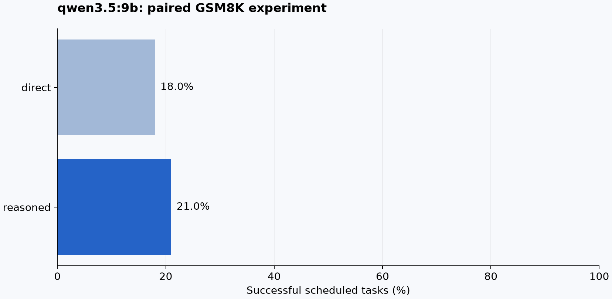
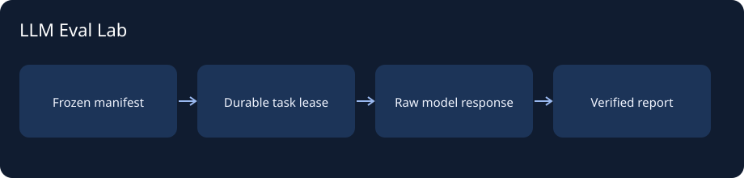

# LLM Eval Lab

[](https://github.com/P-Orion/llm-eval-lab/actions/workflows/ci.yml)

A local-model evaluation system that makes every reported outcome inspectable. Run paired prompts, persist raw responses, recover interrupted tasks, rescore without inference, and browse failures with pinned model/data/source identities.

**[Open experiment browser](https://p-orion.github.io/llm-eval-lab/)** · [Latest recorded run](reports/latest.json) · [Experiment card](docs/EXPERIMENT_CARD.md) · [Failure analysis](docs/FAILURE_ANALYSIS.md)



Latest recorded track: **json output**, **qwen3.5:9b**, 100 frozen GSM8K questions, one seed, internal thinking disabled.

| Prompt | Correct / scheduled | Answer extraction failures | Request failures |
| --- | ---: | ---: | ---: |
| direct | 18/100 | 3 | 0 |
| reasoned | 21/100 | 48 | 0 |

Paired difference: +3.0 percentage points; question-bootstrap 95% interval -4.0 to 10.0. This result concerns the recorded model and protocol. Inconclusive intervals are displayed as such.

## Run an experiment

Python 3.11, [Ollama](https://ollama.com/) and Node 22+. No paid API is required. The dashboard can open recorded reports without model weights.

```sh
python -m venv .venv
# Activate .venv
python -m pip install -e ".[dev]"
llm-eval-lab download
ollama pull qwen3:0.6b
llm-eval-lab run --model qwen3:0.6b --count 20 --format json
# For the recorded larger protocol, use --count 100.
# To reproduce the 9B JSON track (more memory and time):
# ollama pull qwen3.5:9b
# llm-eval-lab run --model qwen3.5:9b --count 100 --format json
```

```sh
cd web
npm ci
npm run build
cd ..
llm-eval-lab serve
```

Open http://127.0.0.1:8013. The hosted demo includes archived runs as well as the latest report. Filter by prompt/outcome, inspect a response, and download its manifest.

## Reliability is part of the evaluation

- A content-derived run ID covers dataset hash, question IDs, prompts, model digest, settings and scorer.
- SQLite transactions claim work with leases. Expired leases can be recovered; stale workers cannot overwrite a newer attempt.
- Re-running the same configuration or using `resume RUN_ID` skips completed tasks. Recovery has **at-least-once model calls**, not an exactly-once inference guarantee.
- Installed model digests are checked before execution. Recorded prompts and settings are used on resume, even if source defaults change.
- `rescore RUN_ID` uses saved responses only. Transport failures remain visible; failed tasks are not silently retried. Wrong answers never earn extra attempts.
- Scheduled-task success, completed-response accuracy, extraction failures and transport failures have separate denominators.

```sh
llm-eval-lab resume RUN_ID
llm-eval-lab rescore RUN_ID
pytest -q
```

The public source GSM8K is MIT-licensed; notices are retained. Question sampling uses seed 42 and records actual IDs. Full 100-question runs include JSONL raw responses and a source snapshot matching the recorded code hash. The archived 20-question legacy pilot predates source-hash and Ollama-version recording; its manifest retains the recorded model digest, data hash and prompts, with that provenance limitation visible.

## Keep the failed experiment

The delimiter pilot found many responses without a valid final `#### NUMBER` line. Those runs remain archived, including the full 100-question paired experiment (9/100 direct, 17/100 reasoned). The JSON-schema track was added afterward to separate format compliance from numerical correctness. Its 0.6B run also remains available (3/100 direct, 1/100 reasoned). A larger-model comparison uses the existing local Qwen3.5 9B on the same questions. These pipeline/model comparisons are exploratory, not independent confirmatory studies.

Both conditions within a JSON run use the same answer schema and model/settings. The scorer reads only the answer field, never guesses from reasoning, and rejects non-finite or unsupported answers. Question-clustered bootstrap keeps seed repeats together.

## Scope and provenance



This is a **new independent, AI-assisted follow-up inspired by BrainBench**. It is not the original senior-design runner and does not reproduce unpublished paper results. It evaluates existing local models; it does not claim to train a foundation model.

CI uses deterministic adapters and injected crashes/failures without an Ollama server. Real inference is recorded separately. Public benchmark contamination, a small sample and one seed limit the conclusions. Latency was recorded while other local benchmark jobs were active; it is not an isolated hardware performance claim.

**Stack:** Python · SQLite · Ollama · numerical verification · FastAPI · React/TypeScript · Vite. [Validation](docs/VALIDATION.md) · [Development](docs/DEVELOPMENT.md)
